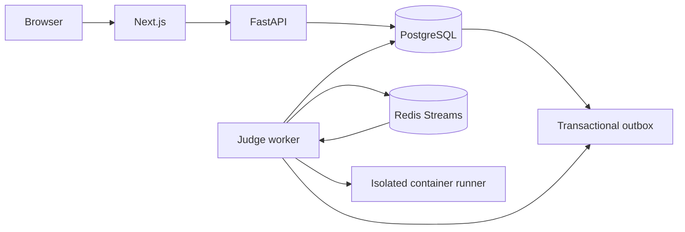

# ForgeJudge

ForgeJudge is a cloud-native coding platform built to make the mechanics of
online judging visible: API boundaries, durable state, queues, isolated workers,
and operational feedback. The Phase 2 judge engine evaluates Python
submissions in disposable, resource-limited Docker containers.

## Quick start

Requirements: Docker with the Compose plugin, or Python 3.12 and Node.js 20+
for running services directly.

```bash
cp .env.example .env
docker compose up --build
```

The API is available at <http://localhost:8000/docs>, the frontend at
<http://localhost:3000>, PostgreSQL at `localhost:5432`, and Redis at
`localhost:6379`. Compose runs database migrations, inserts five starter
problems, and prepares the Python runner image before starting the worker.
The worker requires access to the Docker socket and a shared named workspace
volume. On Linux, set `DOCKER_GID` in `.env` to the group ID owning
`/var/run/docker.sock`. Treat this socket as host-level access: use this setup
only on a trusted development machine. `/health/live` checks the process and
`/health/ready` checks PostgreSQL and Redis.

For local checks without Docker:

```bash
python -m pip install --upgrade pip
python -m pip install -e '.[dev]'
pytest
ruff check .
pip-audit
```

The default `pytest` command runs unit tests. Integration tests require the
Compose PostgreSQL and Redis services and are run with
`pytest -m integration` after `alembic upgrade head` and `python -m scripts.seed`.

Frontend commands are run from `frontend/`:

```bash
npm install
npm run dev
npm run lint
```

## Repository map

- `backend/`: API, worker, shared configuration, domain modules, and migrations.
- `frontend/`: Next.js application.
- `infra/`: local Docker assets, Terraform, Kubernetes/Helm, and monitoring.
- `docs/`: architecture, decisions, diagrams, and operational guidance.
- `tests/`: cross-component tests; service-owned tests live alongside services.
- `.github/workflows/`: continuous integration and deployment workflows.
- `.devcontainer/`: reproducible GitHub Codespaces development environment.

## Architecture direction



The judge worker persists per-test-case
`ACCEPTED`, `WRONG_ANSWER`, `RUNTIME_ERROR`, `TIME_LIMIT_EXCEEDED`, or
`MEMORY_LIMIT_EXCEEDED` results. Each case records runtime and peak memory
metrics. Output comparisons ignore whitespace between tokens. The runner
supports Python 3.12 and uses network-disabled, read-only containers with
memory, CPU, process-count, and output limits. See `docs/architecture/` and
`docs/runbooks/local-development.md` for the sandbox boundary and local setup.

## Project phases

Phase 0 establishes the repository and developer environment. Phase 1 builds
the problem catalog, submission lifecycle, persistence, queue handoff, worker,
seed data, and starter UI. Phase 2 adds isolated Python judging. Authentication,
observability, Azure resources, and production deployment assets follow in
their respective phases.