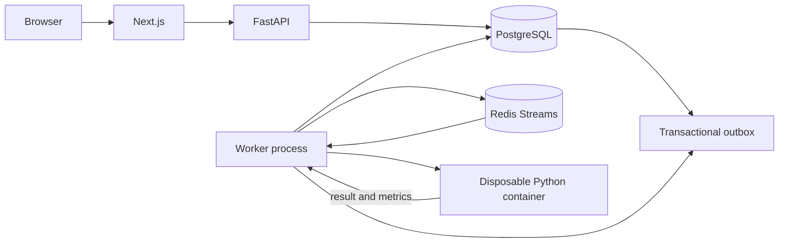

# Architecture Overview

## Phase 2 architecture

The application is a modular Python backend with separate API and worker
processes, a Next.js web app, PostgreSQL as the durable source of truth, and
Redis Streams for asynchronous work. Submission creation records both the
submission and an outbox event in one PostgreSQL transaction; the worker
publishes pending events to Redis, then consumes the stream. The worker
evaluates each test case in a disposable Python Docker container and stores the
case verdict, stdout/stderr, runtime, and memory metric in PostgreSQL.

## Judge execution

- Python 3.12 is the only supported submission language.
- Each test case runs in a new container with no network, a read-only root
  filesystem and workspace, a non-root UID, dropped Linux capabilities,
  `no-new-privileges`, a PID cap, one CPU, a problem-specific memory cap, and an
  external wall-clock timeout.
- The launcher drains stdout and stderr while retaining at most 32 KiB of each,
  preventing unbounded output from consuming worker memory. Output comparison
  is token-based (whitespace between tokens is ignored).
- Runtime is measured around the submitted program. Memory is the cgroup peak
  when available, falling back to the child's maximum resident set size.
- Every configured case is evaluated even when an earlier case fails. The
  submission verdict is the first non-accepted case verdict in test-case order.
- Runner/daemon infrastructure failures mark the submission `FAILED`; user-code
  failures remain completed submissions with a runtime, time, or memory verdict.
- The runner image is pulled by Compose before the worker starts. Direct worker
  deployments must pre-pull the configured image and provide the configured
  shared workspace volume and a Docker-compatible API endpoint.

## Trust boundaries

- The browser is untrusted and communicates through the API.
- The API and worker are separate processes so request handling is not coupled
  to job execution.
- PostgreSQL is the durable source of truth; Redis is a coordination/queue
  component, not the only copy of submission state.
- The outbox closes the database/queue dual-write gap. Publishing may produce
  duplicate stream entries if the worker crashes between Redis publication and
  recording `published_at`; submission status claims make repeated entries safe.
- `COMPLETED` means all configured cases have an evaluated result; the verdict
  may still be `WRONG_ANSWER`, `RUNTIME_ERROR`, `TIME_LIMIT_EXCEEDED`, or
  `MEMORY_LIMIT_EXCEEDED`.
- User source never executes in the API or worker process. Containers have no
  network access and the workspace is mounted read-only.
- Access to a Docker daemon is highly privileged: a compromised worker with
  access to the daemon can request containers beyond the judge's restrictions.
  Local Compose mounts the host socket for convenience and is for trusted
  development only. Production should use a dedicated, isolated rootless daemon
  or a separately secured runner service; do not expose the host Docker socket
  to an internet-facing worker.
- Production Azure resources and network boundaries are deferred to the
  corresponding infrastructure phases.

## Repository ownership

HTTP routing and transport concerns live in `backend/api`; workflows belong in
`backend/services`; persistence adapters live in `backend/repositories`; shared
configuration belongs in `backend/common`. The frontend groups reusable UI in
`components` and workflow-specific code in `features`.