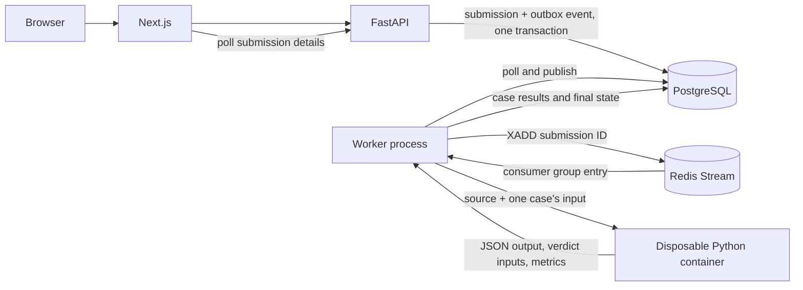

# Phase 2: Judge Engine — Interview Guide

## Pull request review snapshot

Phase 2 is proposed in [PR #1](https://github.com/Ashishkosana/forgejudge/pull/1),
targeting `main`. The PR adds the Python judge execution path, sandbox
configuration, per-test-case result persistence, submission detail UI, tests,
and supporting architecture documentation. At the time this guide was written,
the PR was open and had no submitted reviews or review threads.

The implementation supports Python 3.12. Integration tests and Docker Compose
checks were not runnable in the rebuilt Codespace because Docker, PostgreSQL,
and Redis were unavailable there; unit tests and frontend lint, typecheck, and
build had passed.

## One-minute interview summary

> ForgeJudge accepts Python submissions through a FastAPI API and immediately
> stores them as queued work. It writes the submission and an outbox event in
> the same PostgreSQL transaction, so a committed submission cannot be lost
> just because publishing to Redis fails. A worker publishes pending outbox
> events to a Redis Stream and consumes them with a consumer group. It claims a
> queued submission, loads the problem's test cases, and runs each one in a
> fresh, constrained Docker container. The judge compares program output by
> whitespace-delimited tokens and persists a verdict and measurements for
> every case. PostgreSQL is the durable source of truth; Redis is the
> asynchronous delivery mechanism.

## Architecture

The design separates request handling from code execution:

- **Next.js frontend** presents problems, accepts source code, and shows
  submission status and case-level results.
- **FastAPI API** validates submissions and provides submission and problem
  endpoints.
- **PostgreSQL** stores problem definitions, test cases, submissions, case
  results, and unpublished outbox events.
- **Redis Streams** delivers submission identifiers asynchronously to workers.
- **Worker** publishes outbox rows, consumes stream entries, coordinates
  submission state, and invokes the judge.
- **Disposable Docker containers** run user code. The API and worker never
  execute submitted source inside their own processes.



The durable database/queue handoff is an outbox pattern. This avoids a
dual-write failure where the API commits a submission but fails before queue
publication. It does not make Redis delivery exactly once: a worker could
publish an event and crash before marking its outbox row published. Duplicate
stream entries are therefore expected to be possible, and processing must be
safe to repeat.

## End-to-end data flow

1. A user submits a problem ID, Python source, and language.
2. The API validates the request. The service confirms that the problem is
   published.
3. In one database transaction, the service inserts a `QUEUED` submission and
   a `submission.created` outbox event containing the submission ID. The API
   returns the queued submission with HTTP `202 Accepted`.
4. The worker polls unpublished outbox records, adds their payload to the
   configured Redis Stream, then records `published_at` in PostgreSQL.
5. The worker reads entries from the stream as a consumer-group member.
6. The processor changes the submission from `QUEUED` to `RUNNING`, loads its
   ordered test cases, and judges each case in its own container.
7. The worker persists per-case outcomes, measurements, and captured output;
   then it marks the submission `COMPLETED` with the aggregate verdict.
8. The frontend fetches submission detail and renders current status, overall
   verdict, case results, metrics, and source.

## Database schema explanation

All IDs are UUIDs. The migrations establish the relational model; status and
verdict values are strings constrained to known values, and timestamp mixins
track creation and update times.

| Table | Purpose and important relationships |
|---|---|
| `users` | User identity and role. A submission may refer to a user; deleting a user sets `user_id` to null. Authentication is outside this phase. |
| `problems` | Public problem metadata, difficulty, publication flag, time limit, and memory limit. Slug is unique; positive resource limits are enforced. |
| `test_cases` | Ordered input and expected output for a problem. `(problem_id, position)` is unique. Sample cases can be exposed separately from hidden cases. |
| `submissions` | Submitted source, language, `QUEUED`/`RUNNING`/`COMPLETED`/`FAILED` state, aggregate verdict, and lifecycle timestamps. It references a problem and optionally a user. |
| `submission_results` | One result per `(submission_id, test_case_id)`, including case status, runtime, memory, stdout, and stderr. The pair is unique. |
| `outbox_events` | Event type, aggregate ID, JSON payload, and nullable `published_at`; null means pending publication. An index supports selecting pending events. |

The main relationships are:

```text
users 1 ── * submissions * ── 1 problems 1 ── * test_cases
                         1 ── * submission_results * ── 1 test_cases

outbox_events (aggregate_id = submission ID; intentionally not a foreign key)
```

`submission_results` cascades when a submission or test case is deleted. The
problem reference from a submission uses `RESTRICT`, preventing deletion of a
problem while submissions still refer to it. The outbox's `aggregate_id` is
indexed but intentionally does not declare a database foreign key.

`COMPLETED` means judging finished for all configured cases; it does not mean
the answer was accepted. A completed submission can have `WRONG_ANSWER`,
`RUNTIME_ERROR`, `TIME_LIMIT_EXCEEDED`, or `MEMORY_LIMIT_EXCEEDED`. `FAILED`
is reserved for worker/runner processing failures, with a bounded
`failure_reason`.

## Worker execution flow

The worker loop creates a Redis consumer group, then repeatedly:

1. Publishes a bounded batch of pending outbox events.
2. Reclaims sufficiently idle pending stream entries from failed consumers.
3. Reads new stream entries using `XREADGROUP`.

For each entry, the consumer parses the submission UUID. An invalid ID is
logged and acknowledged so a malformed message does not block the stream. For
a valid ID, the processor loads the submission with its problem and test
cases. A conditional database update changes only a `QUEUED` row to `RUNNING`;
this state claim makes duplicate deliveries no-ops after another worker has
claimed or completed the job. The state transition is committed before
execution.

The processor sends synchronous container work to a thread via
`asyncio.to_thread`, so blocking Docker SDK calls do not block the worker's
async event loop. It evaluates every configured test case, records each
`CaseResult`, and selects the first non-accepted verdict in test-case order as
the submission verdict. It then persists results and completion state.

If processing raises an infrastructure exception, the consumer logs it and
tries to mark an in-progress submission `FAILED`. If that database update
succeeds, the stream entry is acknowledged; if the failure cannot be
persisted, the entry stays pending for later reclaim. SIGINT and SIGTERM set a
stop event and the worker closes its Redis connection on shutdown.

## Sandbox and judge behavior

Each test case runs in a fresh container, with the source, input, and launcher
placed in a temporary shared Docker volume. The sandbox uses:

- no network;
- a read-only container root filesystem and read-only workspace mount;
- non-root UID, all Linux capabilities dropped, and `no-new-privileges`;
- a per-problem memory and swap limit, one CPU, and a PID limit;
- bounded writable temporary filesystems; and
- an external wall-clock timeout.

The launcher executes Python in isolated mode, drains stdout and stderr
concurrently, and retains at most 32 KiB of each stream. It reports exit code,
runtime, peak memory, OOM status, captured output, and truncation flags as JSON.
Runtime is measured around the submitted process; memory uses the container
cgroup peak when available and otherwise the child's maximum resident set
size.

The runner maps a wall-clock timeout to `TIME_LIMIT_EXCEEDED`, container OOM
to `MEMORY_LIMIT_EXCEEDED`, nonzero program exit to `RUNTIME_ERROR`, and
successful execution to a candidate `ACCEPTED`. The evaluator then compares
whitespace-delimited output tokens against expected output. A mismatch becomes
`WRONG_ANSWER`. Truncated stdout is also judged wrong answer because the full
answer cannot be verified. Every case is still run so the result view exposes
the full case breakdown.

The Docker daemon is a significant trust boundary: access to it is highly
privileged even though each judge container is restricted. Local Compose
mounts the host socket for development; a production deployment should isolate
the daemon or use a separately secured runner service.

## Redis flow

Redis is a queue/coordination layer, not the authoritative store. The
configured stream defaults to `forgejudge:submissions`, and the consumer group
defaults to `forgejudge-workers`.

### Outbox publisher

- Select rows where `published_at IS NULL`, ordered by creation time and ID.
- Lock selected rows using `FOR UPDATE SKIP LOCKED`, allowing multiple
  publishers to work without taking the same rows.
- `XADD` each payload plus `event_type` and `outbox_event_id` to the stream.
- Set `published_at` and commit the database transaction.

The Redis write and database commit cannot be atomic together. A crash after
`XADD` but before commit can produce a duplicate on the next poll. This is an
at-least-once handoff; the submission state claim is the deduplication guard.

### Consumer and acknowledgement

- Create the consumer group with stream creation enabled; an existing group is
  accepted.
- Read new entries with `XREADGROUP`, in batches of up to ten.
- Process the referenced submission, then `XACK` successful or durably failed
  work.
- Keep entries pending when failure state cannot be persisted.
- Periodically use `XAUTOCLAIM` to recover entries idle for at least 30
  seconds, such as work left by a crashed worker.

This provides recovery from common worker crashes, but it is not a complete
distributed job scheduler: pending-entry reclaim timing, stream retention,
retry/backoff policy, observability, and horizontal scaling policy need
additional operational design.

## Interview discussion: decisions and trade-offs

### Why use a transactional outbox?

Writing PostgreSQL and Redis independently from the API creates a dual-write
window. If the database commit succeeds but the Redis write fails, a
submission can remain queued forever. Inserting the outbox event with the
submission makes the durable intent to publish atomic with the submission.
The trade-off is a publisher loop and at-least-once delivery, so consumers
must tolerate duplicates.

### Why separate API and worker processes?

User code can be slow, resource-intensive, or malicious. Keeping execution out
of the API process protects request handling from blocking and reduces the
impact of compromised code. The queue also lets submission requests return
quickly with a durable queued state.

### Why a new container for each test case?

It limits cross-case state leakage and gives each case an independent resource
boundary. It costs more container startup time than reusing a worker process,
but makes isolation and per-case accounting easier to reason about.

### How are duplicate jobs handled?

The queue can redeliver. The worker uses a conditional `QUEUED` to `RUNNING`
database update as a claim, and completed or failed submissions are ignored.
This protects database results from ordinary duplicate entries. It does not
provide universal exactly-once execution; crashes during the running window
and recovery policy remain operational concerns.

### How would you scale it?

Scale workers horizontally while keeping PostgreSQL as the source of truth and
using consumer groups for stream distribution. Tune batch size, reclaim idle
time, and worker concurrency with container capacity in mind. At higher
throughput, consider partitioning/stream strategy, queue backpressure, stale
`RUNNING` job recovery, retry policies, and database retention for captured
stdout/stderr. Do not scale Docker-daemon access without a strong isolation
boundary.

### What would you improve next?

I would first close the operational gaps: integration coverage against live
PostgreSQL and Redis, end-to-end sandbox verification on the deployment
runtime, worker recovery for jobs that remain `RUNNING` after a crash, and
production-grade isolation for Docker daemon access. I would also add explicit
resource and output limits for request/test data, queue and judge metrics,
structured retry/dead-letter policy, and retention controls for potentially
sensitive source and output.

## Useful code map

- `backend/services/submissions.py`: atomic submission and outbox creation.
- `backend/worker/outbox.py`: database-to-Redis publication.
- `backend/worker/consumer.py`: consumer group, acknowledgement, and reclaim.
- `backend/worker/processor.py`: submission claim and orchestration.
- `backend/worker/judge.py`: Docker invocation, isolation settings, and verdict
  calculation.
- `backend/worker/sandbox_launcher.py`: execution, output capture, and metrics.
- `backend/repositories/submissions.py`: database state transitions and result
  persistence.
- `backend/models/`: domain entities and judging data types.
- `backend/migrations/versions/`: schema history.
- `frontend/app/submissions/[submissionId]/page.tsx`: case-level result view.
- `docs/architecture/overview.md`: architecture decisions and trust boundary.
