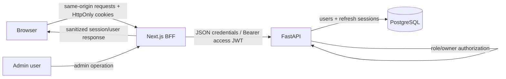

# Phase 3 Plan: Authentication and Authorization

## Status and scope

This is a planning document only. No Phase 3 application code has been
implemented. The recommendations below build on the merged Phase 2 architecture
and should be reviewed before implementation. The related proposed decision is
recorded in [ADR 0003](../adr/0003-authentication-and-session-tokens.md).

### Goals

- Let a person register, authenticate, inspect their account, refresh a
  session, and log out.
- Associate submissions with the authenticated user.
- Restrict user-specific data to its owner and provide explicit admin-only
  capabilities.
- Keep browser-held credentials inaccessible to JavaScript and make refresh
  sessions revocable.
- Preserve the existing API/worker boundary, PostgreSQL source of truth, and
  Phase 2 submission flow.

### Non-goals for the initial increment

- Social login, SSO, organization/multi-tenant membership, MFA, passkeys, and
  account recovery are separate product decisions.
- Phase 3 should not change the judge sandbox or queue architecture.
- Do not build a general-purpose permissions framework until concrete
  requirements need more than the existing user/admin roles.

## Proposed architecture

Use a same-origin Next.js backend-for-frontend (BFF) for browser authentication
and authenticated API calls. FastAPI remains the authority for identity,
session, and authorization decisions. It issues short-lived JWT access tokens
and manages opaque refresh sessions in PostgreSQL. The Next.js server-side BFF
keeps browser credentials in secure, HttpOnly cookies and forwards access
tokens to FastAPI as Bearer credentials. Browser code must not read tokens or
call protected FastAPI endpoints directly.



The BFF is a credential boundary, not an authorization boundary: every
protected FastAPI endpoint independently authenticates the access token and
checks ownership or role. The BFF must not expose token responses to browser
JavaScript, log credentials, or turn an unauthenticated browser input into
arbitrary upstream URLs.

For non-browser clients, a separately documented OAuth-style Bearer access
token contract may be exposed if needed. Do not enable broad credentialed CORS
to support browser calls directly to the API.

## Database changes

Add an Alembic migration; never modify the already-applied Phase 1/2 migration
files. Make the migration safe for existing data, including preflight handling
for duplicate email addresses after normalization.

### `users` changes

The existing `users` table already has UUID `id`, `email`, `display_name`,
`role` (`user`/`admin`), and timestamps. Extend it with:

| Column | Proposed semantics |
|---|---|
| `password_hash` | Nullable Argon2id password hash. Nullable supports pre-existing or future externally provisioned accounts; registration with password writes a hash. |
| `email_verified_at` | Nullable timestamp. Do not imply verification until a verification workflow exists. |
| `is_active` | Non-null boolean, default true; deactivation blocks new authenticated actions and refresh. |
| `last_login_at` | Nullable timestamp for account support and security audit. |

Normalize emails at the service boundary (trim, canonical lowercase) and add a
database-enforced unique constraint/index matching that normalization. The
migration should identify collisions before enforcing it rather than silently
merging accounts. Keep `role` constrained to the known values and never accept
role from public registration or profile-edit input.

### New `refresh_sessions` table

Store one row per login session/device. Suggested columns:

- UUID primary key and `user_id` foreign key with cascade on user deletion.
- `token_hash` (unique), containing only a cryptographic digest of a
  high-entropy opaque refresh token.
- `family_id` UUID to group a rotating token lineage.
- `created_at`, `expires_at`, `last_used_at`, nullable `revoked_at`.
- Nullable `replaced_by_id` self-reference or rotation metadata.
- Optional, bounded `user_agent` and coarse IP metadata only if operationally
  justified; define privacy and retention before collecting them.

Index by user, family, and expiry/revocation lookup needs. Never store a raw
refresh token. A session row is a revocable server-side handle; JWT access
tokens remain short-lived and stateless.

### Relationships and migration behavior

```text
users 1 ── * submissions
users 1 ── * refresh_sessions
refresh_sessions 1 ── 0..1 replacement (rotation lineage)
```

Preserve the existing nullable `submissions.user_id` so historical anonymous
submissions remain valid. New submissions must set it from the authenticated
principal, never from the request body. Existing users should receive
`is_active = true`; existing roles remain unchanged. The migration must be
reversible where practical, with a documented downgrade that drops new session
data and columns only when that data loss is understood.

## User model and authorization

Extend `User` and its response schemas to include authentication state
internally, while never serializing `password_hash` or refresh token fields.
Keep persistence/domain objects separate from public API representations.

Introduce dependencies such as:

- `get_current_user`: validate the access JWT, load the active user, and
  provide a typed principal.
- `require_user`: require an authenticated active account.
- `require_admin`: require the current database role to be `admin`.
- A submission ownership policy: allow access when `submission.user_id`
  matches the principal; define an explicit admin override only where needed.

The JWT should contain the stable user UUID as `sub`; do not trust a role claim
for privileged authorization. Query current account status and role for
admin-only actions so role changes and account deactivation take effect
without waiting for an access-token expiry.

### Admin role

Retain `user` and `admin` as the initial role set. Public registration always
creates `user`. Do not add an unauthenticated “make me admin” path, role field
on public schemas, or email-based implicit privilege. Bootstrap the first
administrator only through a controlled operator command or a one-time,
audited deployment procedure. Admin endpoints should be few, separately
tagged, and covered by negative tests for ordinary users.

## JWT access-token strategy

- Short-lived access JWT, initially target **10 minutes**; tune from UX and
  risk review.
- Sign with an asymmetric keypair (recommended `RS256` for compatibility) or
  an explicitly chosen equivalent. Pin accepted algorithms in verification;
  never accept the algorithm named by an untrusted token without policy.
- Load private/public keys from a secret manager or mounted runtime secret,
  not source control, image layers, or checked-in `.env` files. Include `kid`
  and support key rotation with an overlap period for verification keys.
- Validate signature, `iss`, `aud`, `exp`, `nbf` when present, and token type.
  Use small clock skew allowance. Reject malformed, expired, wrong-audience,
  and wrong-issuer tokens.
- Minimal claims: `sub` (user UUID), `iss`, `aud`, `iat`, `exp`, `jti`, and a
  token-use claim such as `typ=access`. Avoid email and role claims unless
  explicitly justified.
- Keep access tokens in an HttpOnly, Secure, SameSite cookie at the browser
  boundary; only the BFF reads the cookie and sends `Authorization: Bearer`
  to the API. Never put tokens in localStorage, sessionStorage, URLs, or logs.
- Return `401` for missing/invalid authentication and `403` for an
  authenticated principal lacking permission.

## Refresh-token strategy

Use a cryptographically random opaque refresh token (at least 256 bits of
entropy), not a long-lived JWT. Set it as an HttpOnly, Secure, SameSite=Lax
cookie scoped as narrowly as the BFF routing allows. Persist only its
cryptographic hash in `refresh_sessions`.

On refresh:

1. Hash the presented token and find a valid, unrevoked, unexpired session.
2. Confirm the associated user is active.
3. In one transaction, revoke/consume the old token and create a replacement
   token in the same family.
4. Return a new short-lived access token and set the replacement refresh
   cookie.
5. If a consumed token is presented again, treat it as reuse: revoke the
   entire token family, clear browser cookies, and require a new login.

Use a bounded idle timeout and absolute lifetime; proposed initial defaults
are 7 days idle and 30 days absolute, to be confirmed as a product/security
decision. Logout revokes the current refresh session and clears cookies.
Provide a “log out all sessions” operation by revoking all active rows for a
user. Access tokens already issued remain usable only until their short
expiry; if immediate access-token revocation is required, add a denylist or
account token-version check as a separate trade-off rather than silently
claiming stateless JWTs are immediately revocable.

Cookie-authenticated state-changing endpoints need CSRF defenses. Use strict
SameSite policy where compatible, validate `Origin`/`Referer`, and require a
CSRF token/header for unsafe browser requests. Apply CSRF checks at the BFF
boundary and avoid credentialed wildcard CORS.

## API contract

All request/response bodies are JSON except that the BFF sets and clears
cookies. Do not return password hashes or raw refresh tokens to the browser.
The internal FastAPI auth response can return credentials only to the trusted
BFF boundary; deployments must prevent browser clients from bypassing that
boundary if tokens are returned in upstream response bodies.

| Endpoint | Auth | Contract |
|---|---|---|
| `POST /auth/register` | Public | `{email, display_name, password}` → `201` sanitized user/session response; always assigns `user` role. Enforce validation, duplicate-email behavior, and rate limits. |
| `POST /auth/login` | Public | `{email, password}` → `200` sanitized user plus short-lived access credential to the BFF; establishes refresh session/cookie. Generic invalid-credential response. |
| `POST /auth/refresh` | Refresh cookie | Rotates refresh session and returns a new access credential to the BFF; reuse/invalid/expired token returns `401` and clears cookies. |
| `POST /auth/logout` | Refresh cookie and CSRF proof | Revokes current refresh session, clears auth cookies, returns `204`; idempotent where practical. |
| `POST /auth/logout-all` | Authenticated + CSRF proof | Revokes all active refresh sessions for current user; `204`. |
| `GET /auth/me` | Access token | Returns `{id, email, display_name, role}` for the active principal. |
| `GET /submissions` | Authenticated | Return only current user's submissions; admin behavior should be explicit and not inferred from a query parameter. |
| `GET /submissions/{id}` | Authenticated | Return only owner's submission, or an explicit admin-authorized view; return `404` for non-owned rows if avoiding existence disclosure is desired. |
| Admin routes (future in Phase 3 scope) | `require_admin` | Each operation documents its request/response and audit behavior; no generic role mutation endpoint for clients. |

Auth errors should use a consistent shape, for example
`{"detail": "Invalid email or password"}` without revealing which credential
was wrong. Document `400` validation, `401` authentication, `403` permission,
`409` duplicate normalized email, and `429` rate limit responses. Use request
size bounds and schema validation.

## Frontend authentication flow

1. Add sign-up and sign-in routes with accessible forms, validation feedback,
   and loading/submission states.
2. Submit credentials to same-origin Next.js route handlers (BFF), not directly
   to the FastAPI host.
3. The BFF forwards the request to FastAPI over the server-side API connection,
   handles upstream access credentials, and sets Secure/HttpOnly/SameSite
   cookies on the frontend origin. It must not return the raw tokens in JSON
   to client-side JavaScript.
4. On authenticated page/API requests, the BFF reads the HttpOnly access
   cookie, forwards a Bearer token server-to-server, and refreshes once when
   appropriate. Avoid retry loops; on refresh failure clear cookies and
   require sign-in.
5. A `/me` request provides displayable user/role state. Treat that UI state as
   presentation only; the API remains the authorization authority.
6. Logout calls the BFF, revokes the server-side refresh session, clears both
   cookies, and returns the user to a public page.
7. Protect authenticated pages with server-side checks/redirects and protect
   API route handlers independently. Do not rely on client-side route hiding.
8. Add role-aware navigation for administrators, but keep admin API checks
   server-side.

Decide explicitly whether anonymous browsing remains supported. Recommended:
keep published problem catalog and samples public, require login for
submissions and personal submission history, and avoid breaking existing
anonymous submission access without product sign-off.

## Security considerations

- **Password storage:** Use a maintained Argon2id implementation with
  parameters benchmarked for deployment hardware; never store plaintext or
  reversible passwords. Rehash after successful login when parameters change.
- **Credential attacks:** Rate-limit registration, login, and refresh by
  account and source; use generic login errors, bounded backoff, and monitoring
  without logging passwords or tokens.
- **Email identity:** Normalize consistently, enforce uniqueness in the
  database, verify ownership before enabling sensitive account recovery, and
  avoid account enumeration where product requirements call for it.
- **JWT validation:** Pin algorithm and key; validate issuer, audience,
  expiry, token type, and subject; reject `alg=none` and cross-token confusion.
- **Token theft/replay:** Store only refresh hashes, rotate each use, detect
  reuse, revoke the family, expire sessions, and support all-session logout.
- **Browser risks:** HttpOnly/Secure/SameSite cookies, CSRF defenses, strict
  CORS, CSP and XSS hygiene, no token storage in JavaScript-accessible
  persistent storage, and cookie clearing on logout/refresh failure.
- **Authorization:** Derive user ID from verified identity, not payload;
  check ownership on every user resource; check current DB role for admin
  actions; protect against insecure direct object references.
- **Admin safety:** Least privilege, controlled bootstrap, audit sensitive
  actions, and test `403` behavior for non-admin users.
- **Migration safety:** Preflight normalized-email collisions, keep existing
  user and anonymous-submission records valid, and test upgrade/downgrade on a
  database snapshot.
- **Secrets and operations:** Keep signing keys and database credentials out
  of Git, rotate keys, restrict production secret access, redact auth headers
  and cookies in logs, and alert on refresh reuse and unusual login volume.
- **Transport and deployment:** Require HTTPS outside local development,
  secure internal BFF-to-API traffic, and limit direct exposure of credential
  issuing endpoints.
- **Testing:** Cover JWT claim validation, password verification/rehash,
  cookie attributes, CSRF, refresh rotation races/reuse, logout, disabled
  users, ownership, admin authorization, rate limits, and migration behavior.

## Suggested implementation sequence and acceptance criteria

1. **Finalize choices and infrastructure:** confirm auth provider/scope,
   browser cookie domains, key management, expiry/lifetime defaults, and
   operator admin bootstrap.
2. **Schema and user service:** add migration and password/session models;
   verify legacy data, normalized uniqueness, and rollback behavior.
3. **Credential primitives:** implement password hashing, JWT mint/verify,
   refresh-token hashing, rotation, family revocation, and focused tests.
4. **API dependencies and contracts:** register/login/refresh/logout/me,
   current-user dependency, ownership policy, admin dependency, and
   consistent error handling.
5. **Secure submission ownership:** set `user_id` from authentication, scope
   lists/details to the principal, add explicit anonymous compatibility only
   if approved.
6. **Next.js BFF and screens:** add auth forms and route handlers, server-side
   token forwarding/refresh, session-aware navigation, logout, and CSRF
   protections.
7. **Admin and operations:** add only agreed admin capabilities, controlled
   bootstrap, audit events, rate-limit configuration, secret/key rotation
   procedures, and dashboards.
8. **End-to-end verification:** test browser cookies and API authorization
   against live PostgreSQL, verify old submissions/users, and review the
   deployment boundary before release.

Phase 3 is ready for review only when anonymous/registered behavior is
approved, credentials never appear in browser-readable storage or logs,
refresh rotation and replay handling are tested, ownership and admin checks
are enforced server-side, and migration/integration/browser flows pass.
